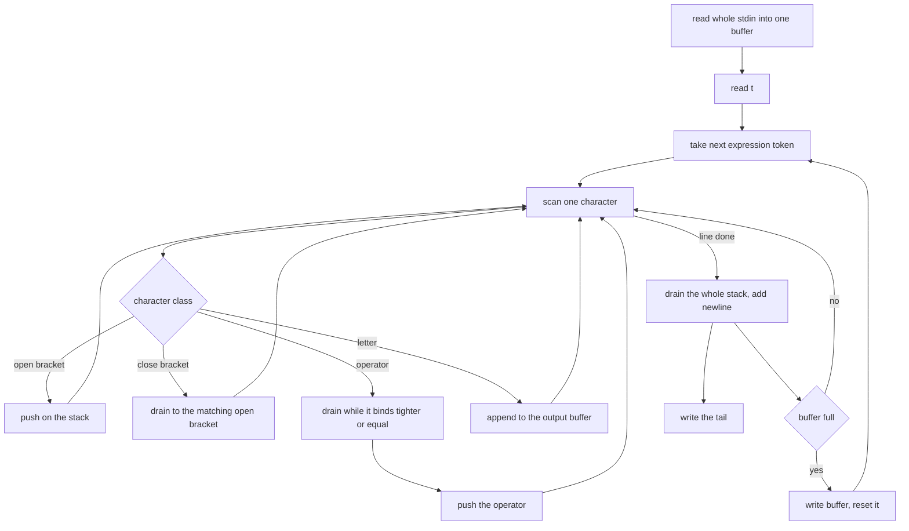

# ONP — Transform the Expression (SPOJ)

<https://www.spoj.com/problems/ONP/>

## Problem

Input: `t`, then `t` fully bracketed infix expressions, one per line.
Output: one Reverse Polish Notation (RPN, postfix) line per expression, in input
order.

Operators are `+`, `-`, `*`, `/`, `^`, listed from lowest to highest priority.
Operands are single lower-case letters. Parentheses group subexpressions, and the
statement promises one RPN form, so no ambiguous chain like `a*b*c` appears.

| item | bound |
|---|---|
| expressions `t` | at most 100 |
| characters per expression | at most 400 |
| operators | 5, all binary |
| operands | one letter `a` to `z` |
| judge limits | 5 s, 256 MB, 50000 B source |

Sample in:

```
3
(a+(b*c))
((a+b)*(z+x))
((a+t)*((b+(a+c))^(c+d)))
```

Sample out:

```
abc*+
ab+zx+*
at+bac++cd+^*
```

## Idea

Scan the expression once. Send letters straight to the answer. Park operators on a
stack, and let a parked operator go when the incoming operator binds tighter or
the same. Parentheses become stack markers that hold back that draining.
Cost per symbol: one stack compare plus one answer append, so O(n) per expression.
Rescanning is slower. A method that finds the last operator by scanning, or that
peels one bracket group per pass, costs O(n^2) character scans.

## Why It Works

RPN places every operator right after its two operands. A parked operator is one
whose right operand is still missing, so it leaves once that operand is complete. The drain rule decides

| term | meaning |
|---|---|
| `stackHeight > 0` | the stack holds at least one symbol |
| `precedence(operatorStack[stackHeight - 1]) > precedence(symbol)` | the parked operator binds tighter, so it is complete |
| `precedence(operatorStack[stackHeight - 1]) == precedence(symbol) and symbol != '^'` | equal priority and left associative, so the left pair is complete |
| `symbol != '^'` | `^` is right associative, so an equal `^` stays parked |

`precedence` returns 0 for `(`, which sits below every operator, so an open bracket is
never drained by accident. A `)` drains down to its own `(` and drops both brackets
from the answer. At the end of the line the leftover operators drain in stack order,
and each one already has both operands, so that order is correct.

Brackets never reach the answer. They only change when draining happens.

Trace of `((a+t)*((b+(a+c))^(c+d)))`. The answer column grows left to right. The
stack column shows the stack from bottom to top.

| char | answer | stack |
|---|---|---|
| `(` | - | `(` |
| `(` | - | `((` |
| `a` | `a` | `((` |
| `+` | `a` | `((+` |
| `t` | `at` | `((+` |
| `)` | `at+` | `(` |
| `*` | `at+` | `(*` |
| `(` | `at+` | `(*(` |
| `(` | `at+` | `(*((` |
| `b` | `at+b` | `(*((` |
| `+` | `at+b` | `(*((+` |
| `(` | `at+b` | `(*((+(` |
| `a` | `at+ba` | `(*((+(` |
| `+` | `at+ba` | `(*((+(+` |
| `c` | `at+bac` | `(*((+(+` |
| `)` | `at+bac+` | `(*((+` |
| `)` | `at+bac++` | `(*(` |
| `^` | `at+bac++` | `(*(^` |
| `(` | `at+bac++` | `(*(^(` |
| `c` | `at+bac++c` | `(*(^(` |
| `+` | `at+bac++c` | `(*(^(+` |
| `d` | `at+bac++cd` | `(*(^(+` |
| `)` | `at+bac++cd+` | `(*(^` |
| `)` | `at+bac++cd+^` | `(*` |
| `)` | `at+bac++cd+^*` | - |

The answer reads `at+bac++cd+^*`, which is the expected third line.



## Code

`flushBlockBytes` is the 128 KiB output block, flushed once the buffer fills.

```nim
const flushBlockBytes = 1 shl 17```

**Priority.** A branch, not a table.

```nim
proc precedence(symbol: char): int =
  if symbol == '+' or symbol == '-': 1
  elif symbol == '*' or symbol == '/': 2
  elif symbol == '^': 3
  else: 0```

Priority 3 is `^`, the tightest operator. `precedence` returns 0 for anything else,
including `(`, which keeps brackets out of the drain rule.

**Expression reader.**

```nim
proc nextToken(inputData: string, i: var int): string =
  while i < inputData.len and inputData[i] <= ' ': i = i + 1
  var j = i
  while i < inputData.len and inputData[i] > ' ': i = i + 1
  if i > j: inputData[j .. i - 1]
  else: ""```

`i` moves by index, so reading a token allocates one string per expression. Every byte at or
below space is a separator, so blank lines and `CR` cannot split or join an
expression.

**Input read.**

```nim
var inputData: string
var line: string
while readLine(stdin, line):
  inputData.add line
  inputData.add "\n"```

The whole input lands in one buffer. One line read per line of the file, no seek
per expression.

**Expression count.**

```nim
var i = 0
var caseCount = 0
for digit in nextToken(inputData, i):
  caseCount = caseCount * 10 + int(digit) - 48```

`caseCount` is built by hand from the digits of the first token. `int(digit) - 48`
is the digit value, with no library call.

**Stack and output buffer.**

```nim
var outputBuffer: string
var operatorStack: array[4096, char]```

`operatorStack` holds 4096 characters, far above the 400 character limit, and it is
allocated
once, outside the per case loop. Reusing it across cases avoids a per-case allocation.

**Case loop and brackets.**

```nim
for _ in 1 .. caseCount:
  var expression = nextToken(inputData, i)
  var stackHeight = 0
  for symbol in expression:
    if symbol == '(':
      operatorStack[stackHeight] = symbol
      stackHeight = stackHeight + 1```

One expression at a time. `stackHeight` is the stack height, a plain integer index.

```nim
    elif symbol == ')':
      while stackHeight > 0 and operatorStack[stackHeight - 1] != '(':
        outputBuffer.add operatorStack[stackHeight - 1]
        stackHeight = stackHeight - 1```

Drain until this expression's own `(`, then drop that `(`. Both brackets stay out of
the answer.

**Operator rule.**

```nim
    elif symbol == '+' or symbol == '-' or symbol == '*' or symbol == '/' or symbol == '^':
      while stackHeight > 0 and (precedence(operatorStack[stackHeight - 1]) > precedence(symbol) or (precedence(operatorStack[stackHeight - 1]) == precedence(symbol) and symbol != '^')):
        outputBuffer.add operatorStack[stackHeight - 1]
        stackHeight = stackHeight - 1
      operatorStack[stackHeight] = symbol
      stackHeight = stackHeight + 1```

Each popped operator already has both operands. A stack entry is pushed once and
popped once, so these two loops cost O(n) per expression, not O(n^2).

**Letters, then the leftover stack.**

```nim
    elif symbol >= 'a' and symbol <= 'z':
      outputBuffer.add symbol
  while stackHeight > 0:
    stackHeight = stackHeight - 1
    outputBuffer.add operatorStack[stackHeight]
  outputBuffer.add "\n"```

Operands go out immediately, which is the RPN rule. The leftover operators then
drain in reverse push order, and the newline keeps one line per expression.

**Output blocks.**

```nim
  if outputBuffer.len >= flushBlockBytes:
    stdout.write outputBuffer
    outputBuffer.setLen 0
stdout.write outputBuffer
```

The buffer flushes every 128 KiB, so memory stays at one block however long the
output runs. `outputBuffer.setLen 0` reuses the allocation, and the last write covers the tail.

## Complexity

| phase | time | space |
|---|---|---|
| input read | one pass over every byte | input bytes |
| one expression of n characters | one scan, at most 2 stack writes per symbol | O(n) stack |
| answer write | one append per symbol, one `write` per 128 KiB block | 128 KiB |
| total, at t = 100, n at most 400 | O(400 t) steps | O(400) stack plus the input buffer |

| measure | Big O |
|---|---|
| time | O(n) per expression, O(total input characters) overall |
| space | O(n) stack, one output block |

A bracket-peeling parser costs O(n^2) character scans, and building a syntax tree
costs two passes plus one node per symbol. The stack holds at most the bracket
depth, so it never exceeds the line length.
