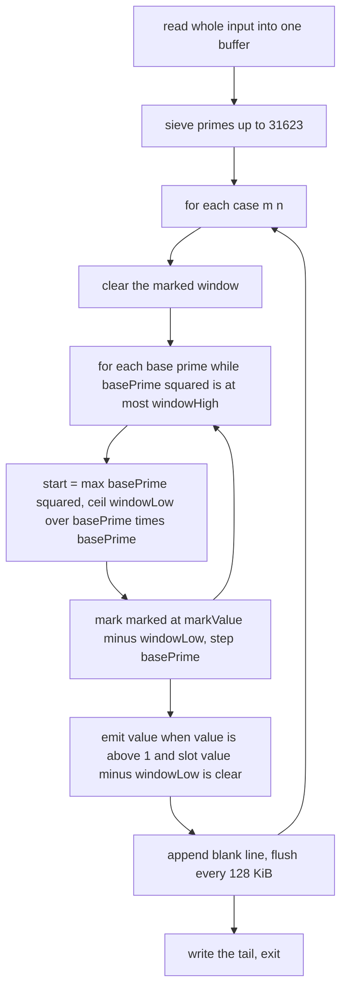

# PRIME1 — Prime Generator (SPOJ)

<https://www.spoj.com/problems/PRIME1/>

## Problem

Input: `t`, then `t` lines of `m n`. Output: every prime in `[m, n]`, one per line,
then one blank line after each test case.

| item | bound |
|---|---|
| test cases `t` | at most 10 |
| `m`, `n` | 1 ≤ m ≤ n ≤ 10^9 |
| window size `n − m + 1` | at most 100 001 |
| primes below 10^9 | 50 847 564 |
| square root of 10^9 | 31 623 |
| judge limits | 3 s, 1536 MB |

Sample in, sample out:

```
1
8 17
```

```
11
13
17

```

## Idea

Sieve the window, not the number line. Primes up to 31 623 are the tool set, and
each tool crosses off its own multiples inside `[m, n]`.
Cost per slot: about 2.3 marks, because a slot is touched once per small factor.
Testing every value is slower. Trial division costs about square root of n
divided by ln n divisions per value, and a full sieve to 10^9 stores 10^9 slots.

## Why It Works

Two facts carry the proof.

1. A composite `x ≤ 10^9` has a prime factor at most square root of x, at most 31
   623. So primes up to 31 623 are enough, and a prime above 31 623 can never mark
   a composite in the range.
2. The window has at most 100 001 slots, so the sieve is indexed by offset from
   `m` instead of by value.

```
full sieve to 10^9:  1 ................................................ 10^9   1 GB
what we need:      999,900,000 == 100 001 slots == 1,000,000,000     131 KB
```

Each prime `p` starts crossing off here:

| term | meaning |
|---|---|
| `ceil(m / p) * p` | the first multiple of `p` that is not below `m` |
| `p * p` | the floor: a smaller multiple of `p` has a smaller factor already |
| `max(p * p, ceil(m / p) * p)` | the first slot that `p` must mark |

Dropping the `p * p` floor is the usual bug. If `p` sits inside its own window,
the bare ceil term crosses off `p` itself.

```
slot   7   8   9  10  11  12  13  14  15
p=7  bare ceil start=7 | x . . . . . . x . |   -> 7 vanishes, wrong answer
p=7  max(49, 7) = 49    | start is past 15, nothing marked, 7 survives
```

Window `[90, 110]`, tools 2, 3, 5, 7, since square root of 110 is below 11:

```
slot:   90  91  92  93  94  95  96  97  98  99 100 101 102 103 104 105 106 107 108 109 110
p=2  start= 90 | x . x . x . x . x . x . x . x . x . x . x |
p=3  start= 90 | x . . x . . x . . x . . x . . x . . x . . |
p=5  start= 90 | x . . . . x . . . . x . . . . x . . . . x |
p=7  start= 91 | . x . . . . . . x . . . . . . x . . . . . |
survivors: 97, 101, 103, 107, 109
```

`91 = 7 * 13` is caught by 7, and 13 is never needed. `1` is not prime, so the
emit loop requires `value > 1`. That one condition is all the special handling the
spec needs, since it already gives `m >= 1`.



## Code

`rootLimit` is floor of square root of 10^9, from fact 1. `flushBlockBytes` is the
128 KiB output block. Both are constants, not per-case values.

```nim
const rootLimit = 31623
const flushBlockBytes = 1 shl 17```

**Base table.** Built once, before any test case.

```nim
proc basePrimes(): seq[int] =
  var composite = repeat(false, rootLimit + 1)
  var primes: seq[int]
  for value in 2 .. rootLimit:
    if not composite[value]:
      primes.add value
      var multiple = value * value
      while multiple <= rootLimit:
        composite[multiple] = true
        multiple = multiple + value
  return primes```

The table holds 3401 primes, 31 KB, and about 7.3 * 10^4 writes. Marking starts at
`value * value` for the same reason as the window rule.

**Window sieve.** One call per test case.

```nim
proc primeList(windowLow, windowHigh: int, smallPrimes: seq[int]): seq[int] =
  var marked = repeat(false, windowHigh - windowLow + 1)
  for basePrime in smallPrimes:
    if basePrime * basePrime > windowHigh: break
    var markValue = max(basePrime * basePrime, (windowLow + basePrime - 1) div basePrime * basePrime)
    while markValue <= windowHigh:
      marked[markValue - windowLow] = true
      markValue = markValue + basePrime
  var primes: seq[int]
  for value in windowLow .. windowHigh:
    if value > 1 and not marked[value - windowLow]: primes.add value
  return primes```

`marked[k]` always means the value `windowLow + k`, so no map or set is involved.
`(windowLow + basePrime - 1) div basePrime * basePrime` is integer `ceil(m / p) * p`.
The line `if basePrime * basePrime > windowHigh: break` stops the tool loop at
square root of n. The window buffer costs 100 KB at worst.

**Token reader.** Digits are scanned by index, so no token object is built.

```nim
proc nextInt(inputData: string, i: var int): int =
  while i < inputData.len and inputData[i] <= ' ': i = i + 1
  var value = 0
  while i < inputData.len and inputData[i] >= '0' and inputData[i] <= '9':
    value = value * 10 + int(inputData[i]) - 48
    i = i + 1
  return value```

`i` is a `var int` parameter, so the scan position survives across calls. A digit
byte becomes `int(inputData[i]) - 48`, with no substring and no parse call. PRIME1 keeps
values positive, so no sign branch is needed.

**Driver.** One read of everything, writes in 128 KiB blocks.

```nim
var smallPrimes = basePrimes()
var inputData: string
var line: string
while readLine(stdin, line):
  inputData.add line
  inputData.add "\n"
var i = 0
var caseCount = nextInt(inputData, i)
var outputBuffer: string
for _ in 1 .. caseCount:
  var windowLow = nextInt(inputData, i)
  var windowHigh = nextInt(inputData, i)
  for prime in primeList(windowLow, windowHigh, smallPrimes):
    outputBuffer.add $prime
    outputBuffer.add "\n"
  outputBuffer.add "\n"
  if outputBuffer.len >= flushBlockBytes:
    stdout.write outputBuffer
    outputBuffer.setLen 0
stdout.write outputBuffer
```

Lines are appended to one buffer, so blank lines and odd spacing cannot desync the
pair reader. `outputBuffer.add $prime` appends digits to the output buffer, and `setLen 0` reuses
the same allocation. The final `stdout.write outputBuffer` covers the tail and is a no-op on
an empty buffer, so a prime-free case still emits its blank line.

## Complexity

| phase | time | space |
|---|---|---|
| input read | one pass per line, then one digit pass per token | input bytes |
| base table | 31 623 times the sum of 1 over p, about 7.3 * 10^4 | 31 KB plus 3401 ints |
| one test case | `(n − m + 1)` times the sum of 1 over p at most square root n | 100 KB |
| output write | one `write` per 128 KiB block | 128 KiB |
| total, at t = 10 | about 2.3 * 10^6 operations, plus output bytes | 131 KB plus 128 KiB |

| measure | Big O |
|---|---|
| time | O(sqrt(n) log log n) for the table, plus O((n − m + 1) log log n) per case |
| space | O(sqrt(n)) plus O(n − m + 1), independent of the 10^9 range |

A full sieve to 10^9 costs O(n log log n) time and O(n) space, which is 1 GB.
Trial division by primes costs O((n − m + 1) sqrt(n) / ln n) divisions. A per-value
primality test costs the same count of values, times a larger constant per value.
